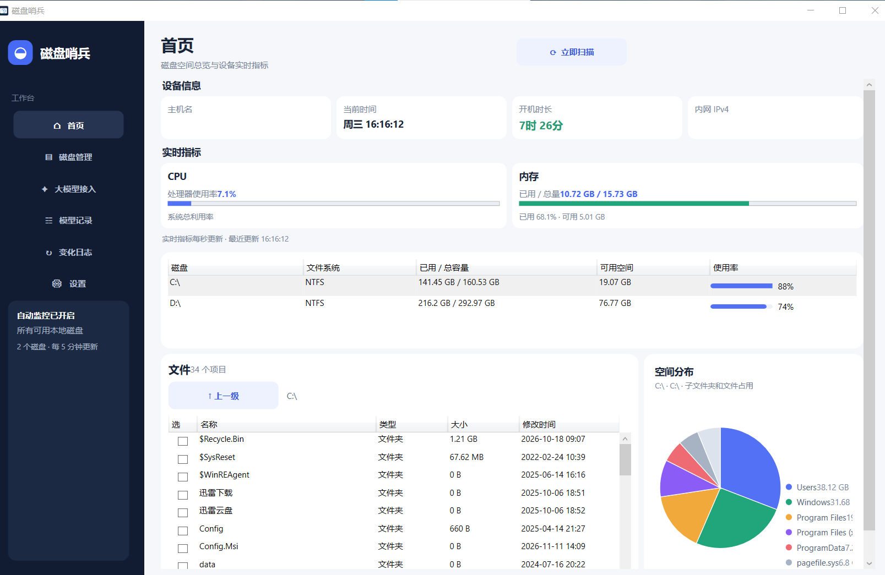
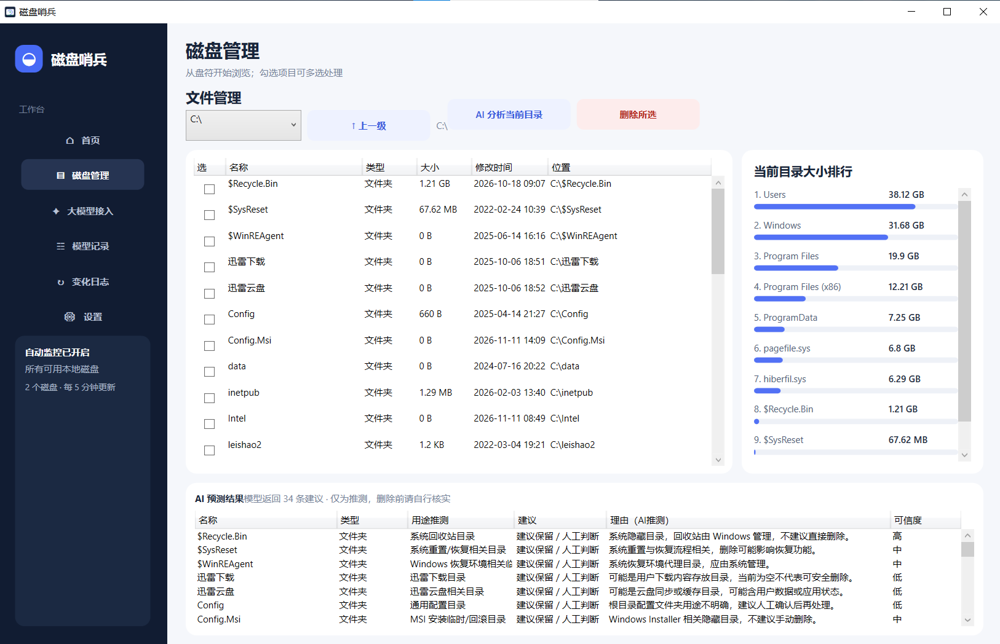
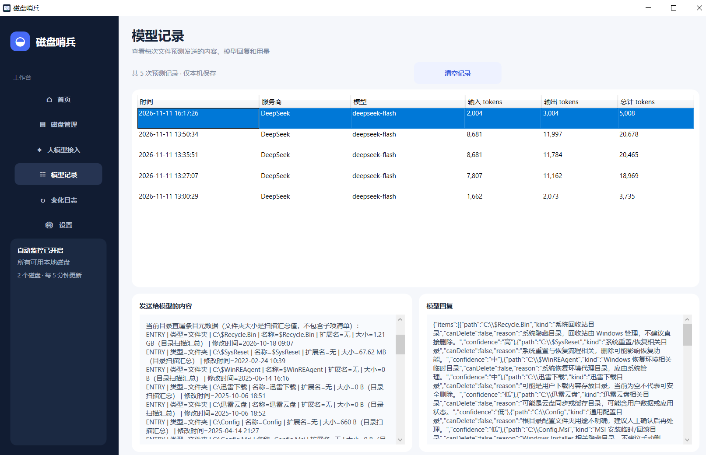
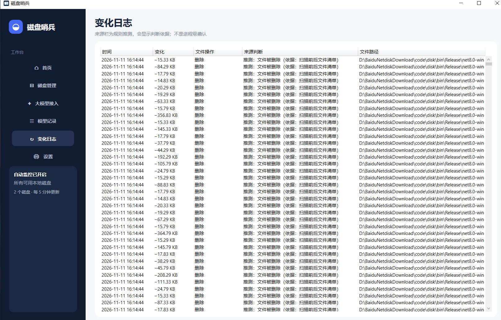

# 纯Vibe Coding

# 磁盘哨兵

Windows 桌面磁盘监控工具。程序自动发现所有可用的本地磁盘，无需手动选择监控盘符。

运行需要 Windows 和 .NET 8 SDK。

## 功能

- **首页磁盘总览**：显示设备信息、CPU 和内存指标、每个磁盘的容量及使用率。
- **磁盘与目录浏览**：在首页查看盘符；浏览当前目录中的文件和文件夹、大小、修改时间及空间分布图。双击文件夹可进入，使用“上一级”返回。
- **磁盘管理**：从盘符开始浏览，支持多选并将文件或文件夹移入回收站；执行前会要求确认。右侧显示当前目录大小排行。
- **定时监控和变化日志**：启动时扫描，之后每 5 分钟扫描一次，也可手动扫描。记录文件新增、删除和大小变化，并根据路径等信息推测来源；推测结果会明确标记，不能确认具体进程。
- **大模型预测**：支持 Claude、Gemini 原生接口，以及 GPT、DeepSeek、Grok/xAI 和其他 OpenAI 兼容接口。分析前会显示发送确认。
- **模型请求记录**：查看每次预测实际发送的元数据、模型回复和 token 用量；token 数读取服务商返回值，没有返回时显示“未提供”。
- **单实例和托盘运行**：关闭窗口会最小化到系统托盘；重复启动会唤醒已有窗口。右键托盘图标可以退出。
- **安装与卸载**：独立安装程序按当前用户安装，可创建开始菜单和桌面快捷方式，并可从 Windows“应用和功能”卸载。卸载时保留本机配置和日志。

## AI 分析范围

AI 分析发送当前目录直属的文件和文件夹条目，包括路径、名称、类型、大小和修改时间。文件夹作为单个条目发送，大小为磁盘扫描的汇总值；不会发送文件内容、子项清单或递归展开目录。删除建议仅供参考，实际删除仍需在磁盘管理页单独确认。

API 密钥使用当前 Windows 用户的 DPAPI 加密后保存在本机，不写入仓库。

## 本机数据位置

默认应用数据目录为 `%LOCALAPPDATA%\DiskSentinel`，保存扫描基线、目录索引和加密后的模型连接。默认日志目录为 `%LOCALAPPDATA%\DiskSentinel\Logs`，保存磁盘变化日志及模型请求记录。可以在程序“设置”页分别修改这两个目录；切换时会复制目标位置中尚不存在的文件，不覆盖已有数据。

路径设置本身保存在 `%LOCALAPPDATA%\DiskSentinel\settings.json`，用于记住自定义目录。

